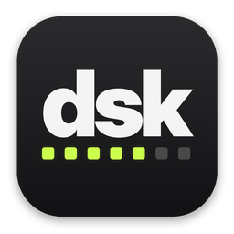
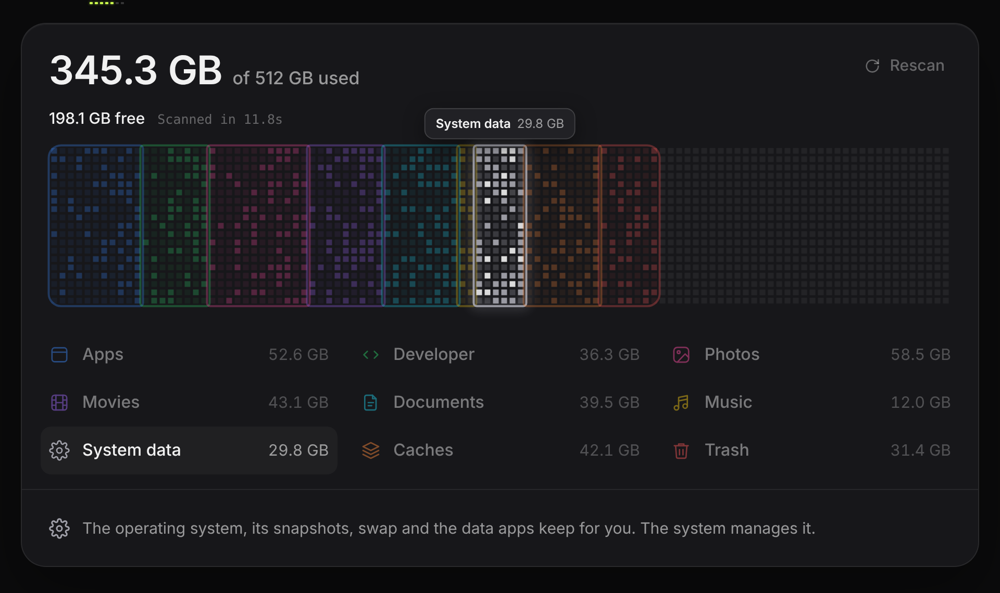

<p align="center">
  
</p>

<h1 align="center">dsk</h1>

<p align="center">
  <b>See what's filling your disk. Clear what's safe.</b><br>
  A live bar of everything on your drive, what you can clear without a second thought, and what to look at first.<br>
  On your own computer, for macOS and Windows.
</p>

<p align="center">
  <a href="https://github.com/YuvrajxGarg/dsk/releases/latest"></a>
  
  <a href="LICENSE"></a>
</p>

<p align="center">
  
</p>

## Download

| Platform | Download | First launch |
|---|---|---|
| **macOS** 11+ · Apple silicon | [**Dsk.dmg**](https://github.com/YuvrajxGarg/dsk/releases/latest/download/Dsk.dmg) | Open it and drag **Dsk** to Applications. The app isn't notarized, so the first time: right-click → **Open**. On macOS 15 and later, go to **System Settings → Privacy & Security → Open Anyway** instead. |
| **Windows** 10 / 11 · 64-bit | [**Dsk-Setup.exe**](https://github.com/YuvrajxGarg/dsk/releases/latest/download/Dsk-Setup.exe) | Run the setup. It installs Dsk for your account (no admin needed) and adds it to the Start menu. If SmartScreen appears, click **More info → Run anyway**. |

Or install it from [PXL](https://github.com/YuvrajxGarg/pxl). Website: [dsk.pxlvzn.in](https://dsk.pxlvzn.in). Dsk checks this repository for new releases and updates itself.

## How it works

1. **Open Dsk.** It measures your disk straight away and fills the bar as it goes: Apps, Developer, Photos, Movies, Documents, Music, System data, Caches and the Trash.
2. **Rest on a part of the bar** (or a category) to see what's in it, with one action where there's something to clear: *Clear caches*, *Empty Trash*.
3. **Clean up** lists everything in three groups:
   - **Safe to clear**: app caches, logs, Xcode build files, package manager caches (npm, pip, cargo, Gradle, pnpm), browser caches, crash reports, temp files. These are rebuilt when needed, and they're ticked for you.
   - **Look first**: installers in Downloads older than a week, `node_modules` and virtual environments in projects you haven't touched for a month, iPhone backups and debug symbols, big files you haven't opened in three months. Never ticked for you.
   - **Leave alone**: your Photos library, iCloud Drive or OneDrive, app data, Docker's disk image, the system. Shown so you know where the space went, with the right way to shrink each one.
4. **Large files** lists the 200 biggest files Dsk found, with filters for *Over 1 GB* and *Not opened in 3 months*.
5. **Move to Trash.** Everything goes to the Trash (Recycle Bin on Windows), so you can put it back. Empty the Trash when you're happy. You can switch the Trash off in Settings to delete straight away.

### Ask Claude

Press **Ask Claude** and Claude reviews every removable item, gives each one a verdict (safe, look first, keep) with a one-line reason, and says what to clear first. You can then select exactly what Claude says is safe. On any item, **What is this?** asks Claude to explain an unfamiliar folder.

Claude only sees paths (with your home folder shortened to `~`), sizes and dates, plus the names of the biggest things inside a folder you ask about. File contents never leave your computer, and Claude's answer only changes the advice: nothing is removed until you press the button. Add your own [Anthropic API key](https://console.anthropic.com/settings/keys) in Settings; it's kept in the macOS Keychain or Windows Credential Manager (or read from `ANTHROPIC_API_KEY`).

### WizTree on Windows

If [WizTree](https://diskanalyzer.com) is installed, Dsk uses it to measure the drive. WizTree reads the NTFS file table directly, so a full scan takes seconds instead of minutes. Dsk runs WizTree's command-line export and reads the result; it asks for admin rights once per scan (you can turn that off in Settings, which makes WizTree slower). Without WizTree, Dsk walks the folders itself.

## Safety

- Dsk only removes what you select, and only after a confirmation that lists every group and size.
- Every path is checked again before it's removed: it has to be inside your own user folder (or Windows' temp folders), and whole folders like your home, Documents, Library, Caches or AppData are refused outright.
- Things inside app bundles and photo libraries never appear as removable files.
- macOS asks once before Dsk can measure Desktop, Documents and Downloads. To measure the Trash and Mail too, add Dsk under **Privacy & Security → Full Disk Access** (Settings has a button for it). Folders Dsk can't read are counted and listed, never shown as empty.

## Command line

```
Dsk scan                 # usage by category and what can be cleared
Dsk scan --json          # the same as JSON
Dsk scan --wiztree       # Windows: measure with WizTree
Dsk clean                # clear everything marked safe (asks first, uses the Trash)
Dsk clean --delete --yes # delete straight away without asking
```

On macOS the binary is `Dsk.app/Contents/MacOS/Dsk`. From source: `python Dsk.py scan`.

## Build from source

```
pip install -r requirements.txt
python Dsk.py                 # open the window
python -m unittest discover tests
./build_mac.sh                # macOS: dist/Dsk.app
build_windows.bat             # Windows: dist\Dsk\Dsk.exe
```

Releases are built by GitHub Actions when `VERSION` changes on `main`: `Dsk.dmg`, `Dsk-Setup.exe`, plus the `Dsk-mac.zip` / `Dsk-windows.zip` the updater uses.

## License

MIT
